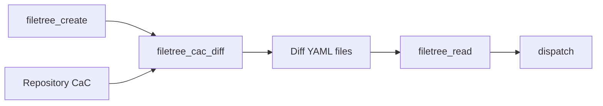

# filetree_object_diff — example usage

This example shows how to synchronize one AAP organization with a Git-backed
Configuration as Code (CaC) repository using the `filetree_object_diff` role.

## Prerequisites

- Ansible Automation Platform 2.5+
- Collections: `infra.aap_configuration_extended`, `infra.aap_configuration`, `ansible.platform`
- Repository CaC in the same directory layout as `filetree_read` / `filetree_create`
- OAuth-capable service account on the target organization

## Repository layout

The role compares **files on disk**: a live export from `filetree_create` against
your Git tree. A typical layout:

```text
/srv/cac/orgs_vars/
└── Default/
    └── env/
        ├── common/
        │   ├── controller_projects.d/
        │   ├── controller_inventories.d/
        │   └── aap_teams.d/
        └── production/
            ├── controller_credentials.d/
            └── controller_hosts.d/
```

CaC YAML files may contain Jinja (`{{ orgs }}`, vault variables). They are
rendered with `filetree_object_diff_template_vars` before comparison.

## Quick start

1. Copy and edit the variable files:

```bash
cp examples/filetree_object_diff/vars/filetree_object_diff.yml.example \
   examples/filetree_object_diff/vars/filetree_object_diff.yml

cp examples/filetree_object_diff/vars/vault.yml.example \
   examples/filetree_object_diff/vars/vault.yml
# ansible-vault encrypt examples/filetree_object_diff/vars/vault.yml
```

1. Preview the delta (no changes applied):

```bash
ansible-playbook playbooks/filetree_object_diff.yml \
  -e @examples/filetree_object_diff/vars/filetree_object_diff.yml \
  -e @examples/filetree_object_diff/vars/vault.yml \
  -e apply_changes=false
```

1. Apply the delta:

```bash
ansible-playbook playbooks/filetree_object_diff.yml \
  -e @examples/filetree_object_diff/vars/filetree_object_diff.yml \
  -e @examples/filetree_object_diff/vars/vault.yml
```

1. Limit to specific object types:

```bash
ansible-playbook playbooks/filetree_object_diff.yml \
  -e @examples/filetree_object_diff/vars/filetree_object_diff.yml \
  -e @examples/filetree_object_diff/vars/vault.yml \
  --tags controller_projects,controller_inventories
```

## What happens



| Step | Component | Result |
| :--- | :-------- | :----- |
| 1 | `filetree_create` | Live state exported under `/tmp/aap_live_export` |
| 2 | `filetree_cac_diff` | Diff files written to `/tmp/aap_cac_delta` |
| 3 | `filetree_read` | Only diff files loaded into Ansible variables |
| 4 | `dispatch` | `state: present` → create/update, `state: absent` → delete |

After a successful apply, the playbook re-runs the diff and asserts that no
delta remains for the managed object types.

## Minimal playbook (role only)

If you already manage authentication and dispatch yourself:

```yaml
- hosts: localhost
  connection: local
  gather_facts: false
  vars:
    orgs: "Default"
    env: common
    dir_orgs_vars: /srv/cac/orgs_vars
    filetree_object_diff_config_dir: "{{ dir_orgs_vars }}/{{ orgs }}"
    aap_hostname: aap.example.com
    aap_oauthtoken: "{{ lookup('env', 'AAP_TOKEN') }}"
  roles:
    - infra.aap_configuration_extended.filetree_object_diff
```

Variables populated by the role (for example `controller_projects`,
`controller_inventories`) contain only the delta and are ready for
`infra.aap_configuration.dispatch`.

## See also

- [`playbooks/filetree_object_diff.yml`](../../playbooks/filetree_object_diff.yml) — full playbook with auth, apply, and convergence check
- [`roles/filetree_object_diff/README.md`](../../roles/filetree_object_diff/README.md) — role variables and design notes
